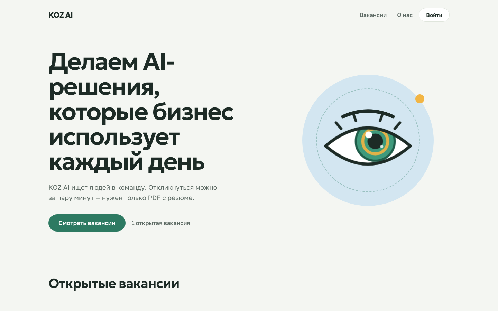
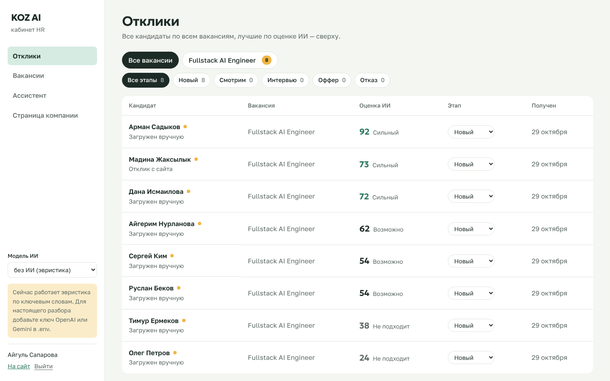
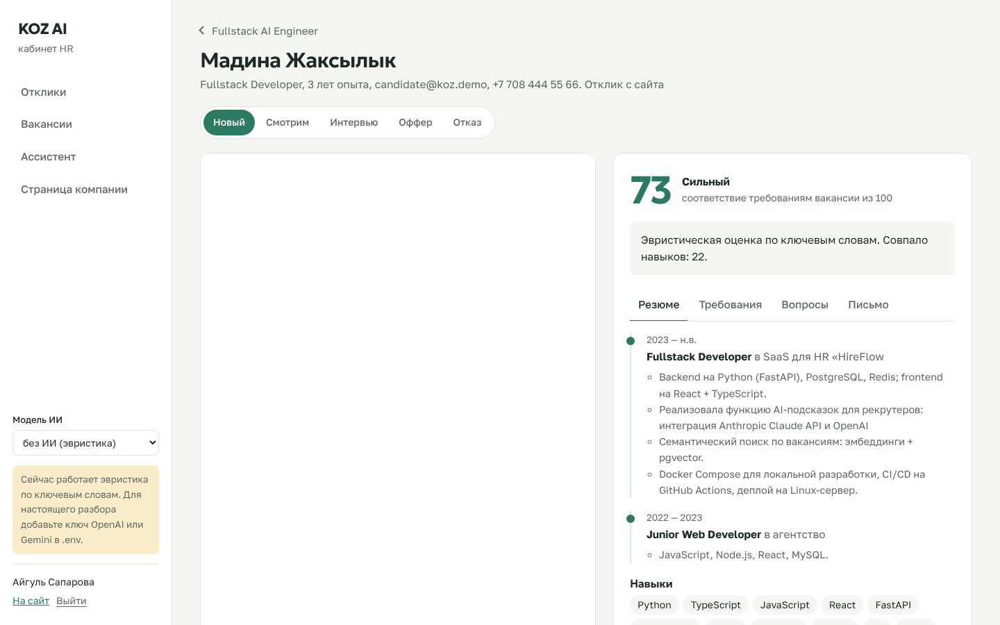
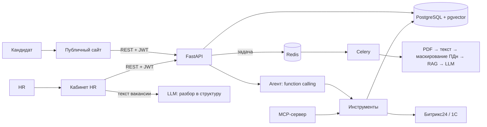

# KOZ Careers — карьерный сайт с AI-скринингом

Двусторонний сервис найма. **Кандидаты** читают о компании, смотрят вакансии и откликаются, прикрепив PDF. **HR** в своём кабинете пишет вакансию свободным текстом (ИИ сам раскладывает её по полям), видит все отклики, открывает PDF резюме и рядом — разбор ИИ: опыт по местам работы, соответствие каждому требованию с цитатами, риски и вопросы для интервью.



| Кабинет HR: отклики | Карточка кандидата |
|---|---|
|  |  |

## Что умеет

**Для кандидата**
- Страница компании и список открытых вакансий без регистрации.
- Отклик за минуту: аккаунт, PDF/DOCX, пара слов о себе.
- Личный кабинет со статусом каждого отклика: отправлен → смотрят → интервью → решение. Можно отозвать отклик — резюме удалится.
- Оценку ИИ кандидат не видит — это внутренний инструмент HR.

**Для HR**
- **Вакансия из свободного текста.** Заметки, абзац, скопированное объявление — ИИ выделяет должность, описание, обязанности, требования (обязательные и «плюсом»), условия, город, формат и зарплату. HR правит и публикует, можно сохранить черновик.
- **Входящие отклики** по всем вакансиям, лучшие по оценке сверху, фильтры по этапам, смена этапа прямо в списке.
- **Карточка кандидата:** оригинал PDF слева, разбор ИИ справа — резюме, раскрытое в структуру (места работы с периодами и достижениями, навыки, образование), матрица требований с цитатами, вопросы для интервью, сопроводительное письмо.
- **Ассистент** — агент с function calling: «у кого был опыт с 1С?», «сравни 1 и 6».
- **Страница компании** редактируется из кабинета.
- Выгрузка кандидата в **Битрикс24** и **1С** (по умолчанию тестовый режим — запрос только пишется в журнал).

**Под капотом**
- Роли и права: JWT, пароли PBKDF2, HR-аккаунт только по коду приглашения, кандидат видит лишь свои отклики и файлы. Права проверяются на бэкенде и покрыты тестами.
- RAG: резюме → фрагменты → эмбеддинги в pgvector (HNSW).
- Structured outputs: ответы модели валидируются Pydantic-схемами, при ошибке — повтор с текстом ошибки.
- Маскирование ПДн (телефоны, email, ИИН) до отправки в модель, защита от prompt injection в резюме.
- Провайдеры: OpenAI, Google Gemini, Anthropic, Ollama/vLLM и `mock` — эвристика без ключей, чтобы всё работало офлайн и в CI.
- Учёт токенов, стоимости и задержки по каждому разбору; eval на размеченном наборе.

## Как это закрывает требования вакансии

| Требование | Где в проекте |
|---|---|
| React + TypeScript | `frontend/` — Vite, строгий TS, React Router, публичный сайт + кабинет HR |
| Python, FastAPI, REST API | `backend/app/main.py` — 29 эндпоинтов, OpenAPI на `/docs` |
| PostgreSQL, проектирование БД | `backend/app/models.py` — пользователи, компания, вакансии, отклики с файлами, чанки, скрининги, журнал интеграций |
| Redis, Celery | кэш ответов LLM, фоновый разбор резюме с ретраями |
| LLM: OpenAI, Anthropic, Google, open-source | `app/llm/` — единый интерфейс, 5 провайдеров |
| Function calling, structured outputs | `app/agent.py`, `app/schemas.py` (`VacancyDraft`, `ScreeningResult`, `ResumeProfile`) |
| RAG, embeddings, векторная БД | `app/rag.py`, pgvector + HNSW |
| AI-агенты, MCP | `app/agent.py`, `app/tools.py`, `app/mcp_server.py` |
| Интеграции с CRM и 1С | `app/integrations.py` |
| Информационная безопасность | `app/auth.py`: роли, JWT, инвайт для HR; маскирование ПДн; удаление данных |
| Оценка качества и стоимости | `backend/eval/run_eval.py` |
| Docker, CI/CD, Linux | `docker-compose.yml`, `.github/workflows/ci.yml` |
| Тестируемый код | 25 тестов, из них 9 — на роли и права |

## Архитектура



Балл кандидата считается в коде: модель только классифицирует каждое требование («есть / частично / нет» + цитата), а итог — взвешенная сумма (обязательные ×2). Так оценку можно объяснить и она не «плавает».

## Быстрый старт

### Windows без Docker

Дважды кликните `start.bat`. Скрипт поставит зависимости, запустит API и сайт, загрузит демо-данные и откроет http://localhost:5173.

Демо-аккаунты (только для локального запуска):
- HR: `hr@koz.demo` / `koz-demo-2026`
- Кандидат: `candidate@koz.demo` / `koz-demo-2026`
- Код приглашения для новых HR: значение `HR_INVITE_CODE` в `.env` (по умолчанию `koz-hr-2026`)

### Подключить ИИ

В `.env` в корне проекта:

```env
LLM_PROVIDER=openai
OPENAI_API_KEY=ваш-ключ
```

или

```env
LLM_PROVIDER=gemini
GOOGLE_API_KEY=ваш-ключ
```

Перезапустите `start.bat`. Модель можно сменить в кабинете HR (селектор слева) и перепроверить кандидата новой моделью.

### Docker

```bash
cp .env.example .env
docker compose up --build -d
python3 scripts/seed.py
```

Сайт: http://localhost:3000, API: http://localhost:8000/docs.

## Оценка качества (eval)

```bash
cd backend
python -m eval.run_eval                                  # baseline (эвристика)
python -m eval.run_eval --provider mock --provider anthropic
```

Метрики: точность вердикта против экспертной разметки (`data/eval_labels.json`), ранговая корреляция Спирмена, устойчивость к prompt injection, $ за резюме, задержка. Результат — `backend/eval/results/latest.md`.

Текущий baseline (эвристика по ключевым словам, без LLM):

| Модель | Точность вердикта | Spearman | Injection-safe | $/резюме |
|---|---|---|---|---|
| mock/heuristic-v1 | 75% | 0.95 | да | 0 |

Baseline специально оставлен «как есть»: он путает сильного бэкендера без фронтенда с fullstack-кандидатом и переоценивает 1С-программиста по совпадению слов. На этих кейсах видно, что даёт LLM — понимание контекста, а не совпадение терминов. Запустите eval со своим ключом и добавьте строку в таблицу.

## MCP: подключить к Claude Desktop / Cursor

```json
{
  "mcpServers": {
    "hr-screener": {
      "command": "python",
      "args": ["-m", "app.mcp_server"],
      "cwd": "/полный/путь/к/backend",
      "env": { "DATABASE_URL": "postgresql+psycopg://hr:hr@localhost:5432/hr" }
    }
  }
}
```

После этого в Claude можно спросить: «Покажи топ-3 кандидатов по вакансии 1 и сравни их».

## API (основное)

| Метод | Путь | Что делает |
|---|---|---|
| POST | `/api/vacancies` | создать вакансию, требования извлекаются автоматически |
| PUT | `/api/vacancies/{id}/requirements` | поправить требования вручную |
| POST | `/api/vacancies/{id}/candidates` | загрузить резюме (multipart, несколько файлов) |
| GET | `/api/vacancies/{id}/candidates` | рейтинг |
| GET | `/api/candidates/{id}` | разбор кандидата + токены/стоимость |
| POST | `/api/candidates/{id}/rescreen?provider=` | перепроверить другой моделью |
| POST | `/api/candidates/{id}/export?system=bitrix24\|1c` | выгрузка |
| DELETE | `/api/candidates/{id}` | удалить ПДн |
| POST | `/api/agent/chat` | диалог с агентом |
| GET | `/api/vacancies/{id}/analytics` | аналитика воронки и стоимости |

Все запросы — с заголовком `X-API-Key`.

## Решения и компромиссы

- **Балл считается в коде, а не моделью.** LLM классифицирует каждое требование, итог — взвешенная сумма. Оценку можно объяснить кандидату и HR, она не «плавает» от запуска к запуску.
- **Mock-провайдер.** Позволяет запускать проект, тесты и CI без ключей и служит baseline для eval.
- **Hash-эмбеддинги по умолчанию.** Работают офлайн и детерминированно; для качественного семантического поиска переключите `EMBEDDING_PROVIDER=openai` или `ollama`.
- **Structured output по-разному у разных провайдеров:** у Anthropic — принудительный вызов инструмента со схемой, у OpenAI-совместимых — JSON mode + валидация Pydantic + один повтор с текстом ошибки (важно для локальных моделей).
- **Dry-run интеграций по умолчанию.** Демо и отладку маппинга полей можно делать, не трогая боевую CRM заказчика.

## Как я бы внедрял у заказчика

1. **Обследование:** как сейчас идёт отбор, сколько резюме в месяц, где живут кандидаты (hh.ru, Битрикс24, 1С:ЗУП), кто принимает решения.
2. **Пилот на одной вакансии:** HR размечает 30–50 прошлых кандидатов → eval на этих данных → договариваемся о целевой метрике (например, «не теряем ни одного кандидата, которого HR пригласил бы»).
3. **Безопасность:** где можно обрабатывать ПДн. Если наружу нельзя — Ollama/vLLM в контуре заказчика, эмбеддинги тоже локально.
4. **Интеграция:** маппинг полей в CRM/1С в dry-run → проверка с ответственным → включение.
5. **Запуск и сопровождение:** мониторинг стоимости и доли ошибок, разбор случаев, где HR не согласился с моделью, — это новые тест-кейсы для eval.

## Ограничения и что дальше

- Нет OCR для сканов PDF (сейчас — понятная ошибка «нужен OCR»).
- Нет восстановления пароля и подтверждения email; для production — письма через SMTP и SSO для HR.
- Файлы резюме хранятся в БД; для больших объёмов — S3/MinIO.
- Кандидату не уходят уведомления о смене этапа — следующий шаг: email или Telegram-бот.
- Миграции через `create_all`; для production — Alembic.
- Следующие шаги: импорт откликов с hh.ru по API, LangGraph-версия агента с шагом согласования перед выгрузкой, ClickHouse для аналитики по большим воронкам.

## Структура

```
backend/app/
  main.py            REST API: публичная часть, кандидат, HR
  auth.py            роли, JWT, пароли
  models.py          пользователи, компания, вакансии, отклики, скрининги
  screening.py       разбор вакансии и резюме, скоринг
  heuristics.py      разбор свободного текста без ИИ (запасной режим)
  rag.py, agent.py, tools.py, mcp_server.py, integrations.py
  llm/               провайдеры OpenAI-совместимые, Anthropic, mock
frontend/src/
  site/              публичный сайт и кабинет кандидата
  hr/                кабинет HR
  illustrations/     персонаж-глаз и иконки (SVG, нарисованы вручную)
data/                вакансия, резюме (txt и pdf), разметка для eval
```
