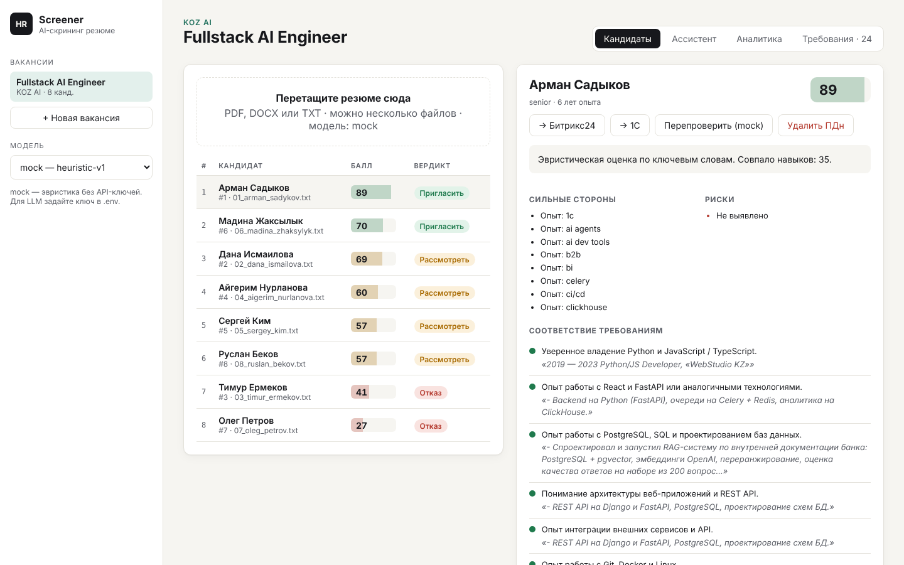
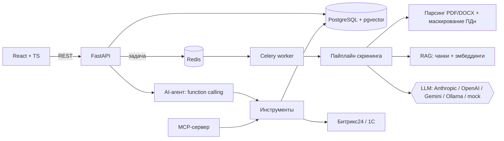
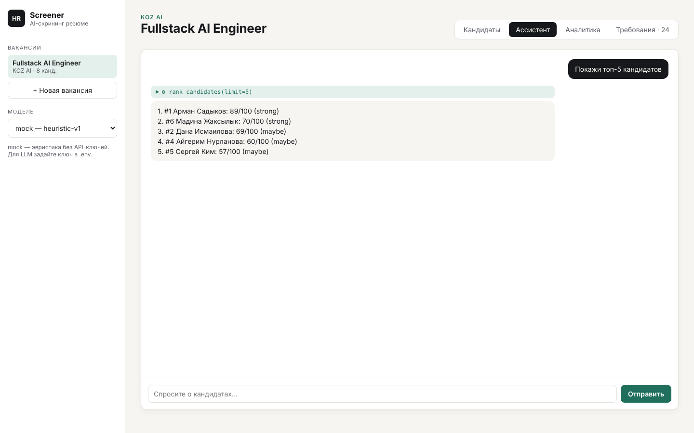
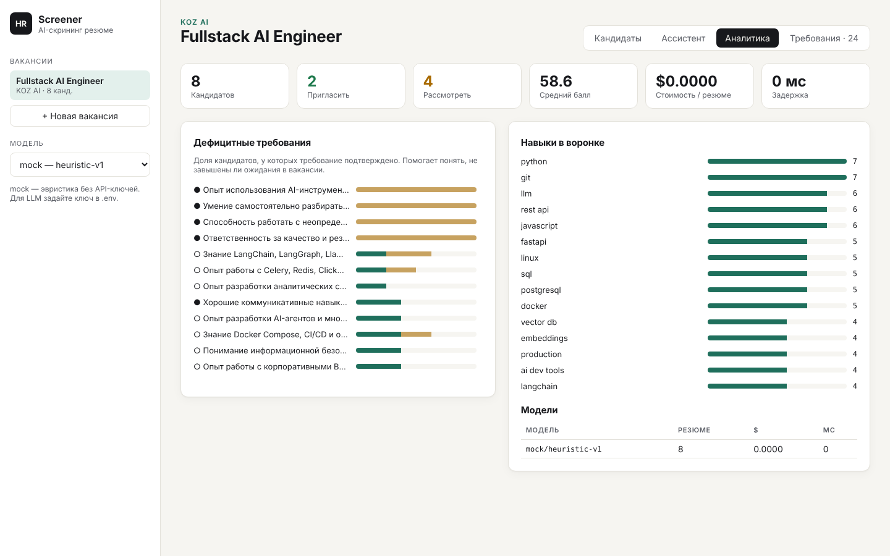

# HR Screener — AI-скрининг резюме

Сервис для рекрутера: загружаешь вакансию и пачку резюме — получаешь рейтинг кандидатов с разбором по каждому требованию, цитатами-доказательствами из резюме, рисками и вопросами для интервью. Есть AI-ассистент, который отвечает на вопросы о кандидатах через инструменты, и выгрузка кандидатов в Битрикс24 и 1С.



Демо-данные — реальная вакансия **Fullstack AI Engineer (KOZ AI)** и 8 вымышленных резюме с экспертной разметкой.

## Что умеет

- **Извлечение требований из вакансии** — LLM превращает свободный текст в список проверяемых требований (обязательные / «будет преимуществом»). HR может их поправить.
- **Скрининг** — для каждого требования: `met / partial / missing` + дословная цитата из резюме. Итоговый балл 0–100 (обязательные ×2) и вердикт: пригласить / рассмотреть / отказ.
- **RAG** — резюме режутся на фрагменты, эмбеддинги хранятся в **pgvector** (HNSW-индекс). Для длинных резюме в LLM уходят только релевантные фрагменты.
- **AI-агент** — цикл function calling: рейтинг, семантический поиск («у кого был опыт с 1С?»), сравнение кандидатов, выгрузка в CRM.
- **MCP-сервер** — те же инструменты доступны из Claude Desktop, Claude Code, Cursor.
- **Мультипровайдерность** — Anthropic, OpenAI, Google Gemini, локальные модели через Ollama/vLLM, плюс `mock` (эвристика без ключей). Переключается в UI.
- **Стоимость и качество** — по каждому скринингу пишутся токены, $ и задержка; eval-скрипт сравнивает модели на размеченном наборе.
- **Безопасность ПДн** — телефоны, email, ИИН, Telegram маскируются *до* отправки в LLM; контакты хранятся только у нас; удаление кандидата по запросу; защита от prompt injection в резюме (есть тест-кейс).
- **Интеграции** — Битрикс24 (`crm.lead.add` через вебхук) и 1С (OData). По умолчанию dry-run: запрос пишется в журнал, но не уходит.

## Как это закрывает требования вакансии

| Требование вакансии | Где в проекте |
|---|---|
| React + TypeScript | `frontend/` — Vite, строгий TS, 4 экрана |
| Python, FastAPI, REST API | `backend/app/main.py` — 14 эндпоинтов, OpenAPI на `/docs` |
| PostgreSQL, проектирование БД | `backend/app/models.py` — вакансии, кандидаты, чанки, скрининги, журнал интеграций |
| Redis | кэш LLM-ответов (`app/cache.py`) + брокер Celery |
| Celery, фоновые задачи | `app/tasks.py` — скрининг асинхронно, ретраи с backoff |
| Интеграция LLM API: OpenAI, Anthropic, Google, open-source | `app/llm/` — единый интерфейс, 5 провайдеров |
| Function calling, structured outputs | `app/agent.py`, `app/schemas.py` (Pydantic-схема ответа, валидация + повтор) |
| RAG, embeddings, векторная БД | `app/rag.py`, `app/embeddings.py`, pgvector + HNSW |
| AI-агенты | `app/agent.py` + `app/tools.py` |
| MCP | `app/mcp_server.py` |
| Локальные LLM | профиль `ollama` в docker-compose, `LLM_PROVIDER=ollama` |
| Интеграция с CRM и 1С | `app/integrations.py` — Битрикс24 REST, 1С OData, журнал запросов |
| Оценка качества, скорости, стоимости | `backend/eval/run_eval.py`, вкладка «Аналитика» |
| Аналитика / BI | дефицитные требования, навыки в воронке, стоимость по моделям |
| Информационная безопасность | маскирование ПДн, API-ключ, защита от prompt injection, non-root контейнеры, удаление ПДн |
| Git, Docker, Docker Compose, Linux | `docker-compose.yml`, Dockerfile'ы |
| CI/CD | `.github/workflows/ci.yml` — линтер, тесты, smoke на pgvector, eval, сборка образов |
| Тестируемый код | 16 тестов: unit, API, адаптеры провайдеров, MCP |
| Работа с B2B-заказчиком | раздел «Как я бы внедрял у заказчика» ниже |

## Архитектура



Пайплайн одного резюме: текст → маскирование ПДн → чанки → эмбеддинги в pgvector → для каждого требования ищем фрагменты-доказательства → LLM возвращает JSON по схеме `ScreeningResult` → считаем балл детерминированно в коде (а не просим модель «поставить оценку»: так балл объясним и стабилен).

| Ассистент | Аналитика |
|---|---|
|  |  |

## Быстрый старт

### Через Docker (рекомендуется)

```bash
cp .env.example .env          # по умолчанию LLM_PROVIDER=mock — ключи не нужны
docker compose up --build -d
python3 scripts/seed.py       # демо-вакансия KOZ AI + 8 резюме
```

- UI: http://localhost:3000
- API и Swagger: http://localhost:8000/docs

### Подключить настоящую LLM

В `.env`:

```env
LLM_PROVIDER=anthropic
ANTHROPIC_API_KEY=sk-ant-...
```

Или `openai` / `gemini`. Провайдера можно менять в UI на лету — у кандидата есть кнопка «Перепроверить».

### Локальная модель (закрытый контур)

```bash
docker compose --profile local up -d
docker compose exec ollama ollama pull qwen2.5:7b
# в .env: LLM_PROVIDER=ollama
```

### Без Docker (Windows / macOS / Linux)

Нужны Python 3.11+, Node 20+, PostgreSQL с расширением pgvector и Redis. Для самого быстрого старта можно без них: SQLite и синхронный режим.

```bash
cd backend
pip install -r requirements-dev.txt
# Windows PowerShell:  $env:DATABASE_URL="sqlite:///./dev.db"; $env:CELERY_EAGER="true"
export DATABASE_URL=sqlite:///./dev.db CELERY_EAGER=true
uvicorn app.main:app --reload

cd ../frontend && npm install && npm run dev   # http://localhost:5173
```

## Оценка качества (eval)

```bash
cd backend
python -m eval.run_eval                                  # baseline (эвристика)
python -m eval.run_eval --provider mock --provider anthropic
```

Метрики: точность вердикта против экспертной разметки (`data/eval_labels.json`), ранговая корреляция Спирмена, устойчивость к prompt injection, $ за резюме, задержка. Результат — `backend/eval/results/latest.md`.

Текущий baseline (эвристика по ключевым словам, без LLM):

| Модель | Точность вердикта | Spearman | Injection-safe | $/резюме |
|---|---|---|---|---|
| mock/heuristic-v1 | 75% | 0.95 | да | 0 |

Baseline специально оставлен «как есть»: он путает сильного бэкендера без фронтенда с fullstack-кандидатом и переоценивает 1С-программиста по совпадению слов. На этих кейсах видно, что даёт LLM — понимание контекста, а не совпадение терминов. Запустите eval со своим ключом и добавьте строку в таблицу.

## MCP: подключить к Claude Desktop / Cursor

```json
{
  "mcpServers": {
    "hr-screener": {
      "command": "python",
      "args": ["-m", "app.mcp_server"],
      "cwd": "/полный/путь/к/backend",
      "env": { "DATABASE_URL": "postgresql+psycopg://hr:hr@localhost:5432/hr" }
    }
  }
}
```

После этого в Claude можно спросить: «Покажи топ-3 кандидатов по вакансии 1 и сравни их».

## API (основное)

| Метод | Путь | Что делает |
|---|---|---|
| POST | `/api/vacancies` | создать вакансию, требования извлекаются автоматически |
| PUT | `/api/vacancies/{id}/requirements` | поправить требования вручную |
| POST | `/api/vacancies/{id}/candidates` | загрузить резюме (multipart, несколько файлов) |
| GET | `/api/vacancies/{id}/candidates` | рейтинг |
| GET | `/api/candidates/{id}` | разбор кандидата + токены/стоимость |
| POST | `/api/candidates/{id}/rescreen?provider=` | перепроверить другой моделью |
| POST | `/api/candidates/{id}/export?system=bitrix24\|1c` | выгрузка |
| DELETE | `/api/candidates/{id}` | удалить ПДн |
| POST | `/api/agent/chat` | диалог с агентом |
| GET | `/api/vacancies/{id}/analytics` | аналитика воронки и стоимости |

Все запросы — с заголовком `X-API-Key`.

## Решения и компромиссы

- **Балл считается в коде, а не моделью.** LLM классифицирует каждое требование, итог — взвешенная сумма. Оценку можно объяснить кандидату и HR, она не «плавает» от запуска к запуску.
- **Mock-провайдер.** Позволяет запускать проект, тесты и CI без ключей и служит baseline для eval.
- **Hash-эмбеддинги по умолчанию.** Работают офлайн и детерминированно; для качественного семантического поиска переключите `EMBEDDING_PROVIDER=openai` или `ollama`.
- **Structured output по-разному у разных провайдеров:** у Anthropic — принудительный вызов инструмента со схемой, у OpenAI-совместимых — JSON mode + валидация Pydantic + один повтор с текстом ошибки (важно для локальных моделей).
- **Dry-run интеграций по умолчанию.** Демо и отладку маппинга полей можно делать, не трогая боевую CRM заказчика.

## Как я бы внедрял у заказчика

1. **Обследование:** как сейчас идёт отбор, сколько резюме в месяц, где живут кандидаты (hh.ru, Битрикс24, 1С:ЗУП), кто принимает решения.
2. **Пилот на одной вакансии:** HR размечает 30–50 прошлых кандидатов → eval на этих данных → договариваемся о целевой метрике (например, «не теряем ни одного кандидата, которого HR пригласил бы»).
3. **Безопасность:** где можно обрабатывать ПДн. Если наружу нельзя — Ollama/vLLM в контуре заказчика, эмбеддинги тоже локально.
4. **Интеграция:** маппинг полей в CRM/1С в dry-run → проверка с ответственным → включение.
5. **Запуск и сопровождение:** мониторинг стоимости и доли ошибок, разбор случаев, где HR не согласился с моделью, — это новые тест-кейсы для eval.

## Ограничения и что дальше

- Нет OCR для сканов PDF (сейчас — понятная ошибка «нужен OCR»).
- Аутентификация — один API-ключ; для production нужны пользователи и роли (JWT/SSO).
- Миграции через `create_all`; для production — Alembic.
- Следующие шаги: импорт откликов с hh.ru по API, LangGraph-версия агента с шагом согласования перед выгрузкой, ClickHouse для аналитики по большим воронкам.

## Структура

```
backend/
  app/
    main.py            REST API
    models.py          SQLAlchemy-модели (pgvector)
    screening.py       пайплайн скрининга и скоринг
    rag.py             чанки, векторный поиск
    agent.py, tools.py AI-агент и инструменты
    mcp_server.py      MCP-сервер
    integrations.py    Битрикс24, 1С
    llm/               провайдеры: anthropic, openai-совместимые, mock
  eval/run_eval.py     оценка качества и стоимости
  tests/               pytest
frontend/src/          React + TypeScript
data/                  вакансия, резюме, разметка
```
